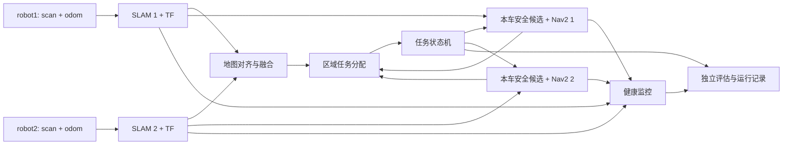

# 双机主动 SLAM V4 架构重设计

日期：2026-10-17。本文是实施设计，不是已经验证的算法结果。V3 原始代码、44 组正式实验和 post44 试跑保持冻结；V4 使用独立包与独立实验目录。主要依据为 `bishe-transfer-v3/unpacked/V3/` 中的阶段报告、r11 验证报告与 `coordinator_post44.py`、`planning.py`、`active_slam_post44.launch.py`。

## 1. 为什么需要重设计

- 44 组正式实验：15 组完成并返航、8 组探索达标但返航失败、21 组超时；走廊 14/14 超时。旧 ROI 外接矩形导致部分已探索区域无法达标，但 17 组超时同时未达两个门槛，不能把失败全归因于 ROI。
- r11 走廊在约 180 仿真秒后进入覆盖平台，此后有 126 次 `path_failed`、159 次 `no_candidate`，最终只达到 59.83%。上游原因尚未确认，必须在地图、TF、代价地图、候选点和导航服务之间定位。
- V3 把实验评估、地图融合、候选选择、Nav2 调用、奖励、回程以及修复逻辑放在相互继承的协调器中。r11 还把墙上时间用于目标冷却、把仿真时间用于部分停滞判断；这可能使 VM 负载改变策略行为，需在 V4 中消除。
- 返航日志有控制器无进展、零长度路径及 TF 外推。返航不能只作为探索后的附加动作，应是单独可回放、可诊断的任务阶段。

## 2. 目标与边界

V4 第一目标是**可靠完成双车建图、探索与返航**。固定仿真预算内两车完成任务的比例是主指标；探索达标率与达标后返航率分别报告。第二目标才是降低达到固定覆盖率所需的仿真时间。

V4 第一版不把 Q 学习放在核心执行链路。保留 V2 共享 Q 表作为独立实验插件，待确定性基线稳定后再比较。在线算法只读取激光、里程计、SLAM 地图、TF 与 Nav2 状态；SDF 真值只进入独立评估器。旧 ROI 与新 ROI 不混算，比较旧 V3 时须在相同定义下重跑。

## 3. 组件与数据流

| 组件 | 唯一职责 | 对外结果 |
|---|---|---|
| `robot_stack/<name>` | 每车 `slam_toolbox`、动态 `map_i→odom_i`、Nav2 生命周期与局部控制 | 带时间戳的位姿、地图、路径查询、导航结果 |
| `alignment_fusion` | 管理 `T_global_map_i`，检查两图重叠、时间与占据冲突，只在对齐可信时发布公共图 | 公共图、地图版本、对齐状态与冲突统计 |
| `candidate_planner` | 从本车已知安全空闲区生成观测位姿，估计可见未知格，并让**本车 Nav2**确认路径 | 候选、预计收益、路径成本、拒绝原因 |
| `allocator` | 按区域给双车分派不重叠目标；目标持有租约，完成/失败/地图变化时释放 | 分配决策及依据 |
| `mission_executor` | `STARTUP → EXPLORE → RETURN → COMPLETE/FAILED`；管理目标生命周期和有限重试 | 明确的阶段、结果和故障码 |
| `health_monitor` | 检查传感器心跳、TF 年龄、SLAM 地图年龄、Nav2 active、成本图和进度 | 健康状态；异常时阻止继续派发目标 |
| `evaluator` | 读取真值计算可达覆盖和预先冻结的 ROI；记录仿真时间与墙上时间 | 独立结果、逐次事件和可回放快照 |

**地图使用原则：**公共融合图负责“哪里值得去”和双车分工；每车的 Nav2 使用与本车定位一致的地图/代价地图来判断“能不能到”。公共目标先转换到本车地图坐标，确认转换新鲜且有路径才执行。若地图对齐无效，暂停跨车分配，维持安全的本车局部探索或结束为 `alignment_unhealthy`，不能继续信任一个看似完整的公共图。仿真可用已知出生关系初始化变换，但要显式校验，不再默认为单位变换可通用。

**时间原则：**目标租约、冷却、切换滞后、停滞窗口与任务预算一律使用 ROS 仿真时间；墙上时间只用于启动卡死和主机资源看门狗。每次决策记录 `sim_time`、`wall_time` 与地图版本。

## 4. 执行与故障处理

1. `STARTUP`：两车的 scan/odom、SLAM 图、动态 TF、Nav2 lifecycle 与基础路径查询全部就绪后才进入探索。就绪失败记 `startup_failure`，不算策略超时；以状态门禁取代固定的 8/22/36 秒启动延时。
2. `EXPLORE`：按 frontier 簇生成少量观察位姿；先检查已知空闲、足迹余量、地图边界和本车连通性，再用本车 Nav2 路径确认。评分先使用预计新可见格 / 预计到达时间、失败惩罚和双车重叠惩罚。一个区域无路径时记录 `map_or_costmap_disconnected` 与快照，不在同一地图版本反复探测。
3. `NAVIGATE`：每个目标有不可变 ID、地图版本、派发时间、最长执行时间和状态。仅在到达、失效、实际收益过低、Nav2 失败或明确更优目标出现时重规划。导航失败按“无路径、控制器无进展、TF 过期、障碍阻断、取消”分类；恢复动作有限次且计数。
4. `RETURN`：进入返航前分别检查两车到出生点的路径。窄门通行按区域租约排队；每段从实时位姿重新求路。控制器失败时保存快照并执行有上限的恢复；不得无限重复同一路点。返航可从保存的终点状态单独回放。
5. `COMPLETE/FAILED`：区分 `coverage_timeout`、`no_reachable_frontier`、`navigation_failed`、`return_failed`、`localization_unhealthy`、`startup_failure` 和 `runtime_error`。每次运行只给一个终态，同时保留探索是否达标、返航是否成功两个正交字段。

## 5. 开发顺序与验收门

| 阶段 | 实现 | 进入下一阶段的条件 |
|---|---|---|
| A. 故障诊断 | 用 r11 `decisions.csv` 与日志锁定走廊平台期和失败目标；做一次带快照采集的复现，在失败时保存 SDF 可达图、两张 SLAM 图、融合图、全局/局部代价地图、TF 与目标。旧包仅有终点融合图，没有故障时刻的代价地图和 TF 快照。 | 对通道断开或路径失败提出有截图和数值支持的具体原因。 |
| B. 单车执行栈 | 独立单车 SLAM + Nav2 + 健康门禁；固定目标穿门和返航。 | room、corridor、loop 中重复试跑均能解释所有失败；无启动未就绪误判为策略超时。 |
| C. 双车地图 | 双车 TF 对齐、融合质量监控和本车路径验证。 | 重叠墙体无明显双影，候选与本车 Nav2 地图一致；失准能被检测并停止错误派发。 |
| D. 确定性探索 | 安全观察位姿、路径成本、区域租约、有限失败恢复。 | 至少 room 与 corridor 各 3 次完整功能试跑，逐次保存目标与失败日志；不把单次成功当性能证明。 |
| E. 独立返航 | 门口通行权、实时重规划、终点快照回放。 | 从多种保存的探索终点重复返航，失败有唯一可追踪原因。 |
| F. 正式比较 | 同一 ROI、传感器、地图、种子、出生点和预算下，V4 无分工/V4 有分工/V4 加学习插件依次消融。 | 先 3 种地图 × 5 个配对种子；报告成功比例、覆盖率曲线、返航条件成功率和配对差值区间。超时保留。 |

第一轮工程验收可以设为每张关键地图至少 10 次重复运行、启动就绪 10/10、任务完成至少 9/10；这是项目目标，不是现有数据支持的性能结论。未达标时回到对应组件修复，不叠加新策略。

## 6. 实施边界

V4 应新建 `active_slam_v4` 包及运行器，逐步移植 V3 中已验证有用的纯算法函数与日志格式；不要沿用 `OptimizedCoordinator → Post44Coordinator` 的继承层叠。`GroundTruth`、ROI 与成功判定只能由评估进程导入。原始 V2/V3 包、44 组目录与 post44 目录均不修改。第一项可执行工作是阶段 A 的走廊失败快照诊断，诊断结论决定阶段 B/C 的具体修复参数。
